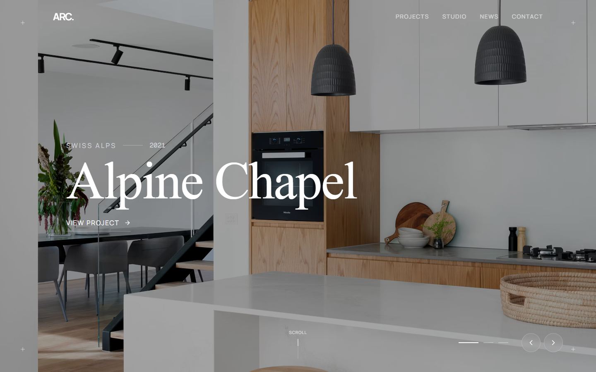
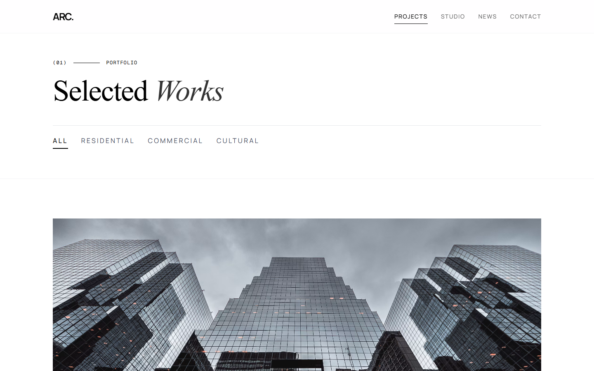
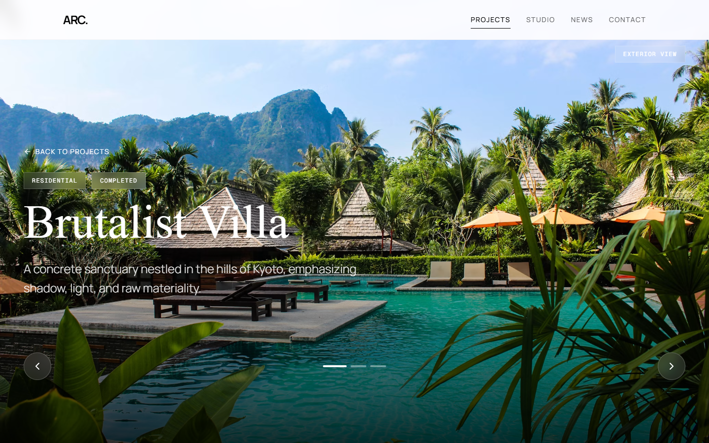
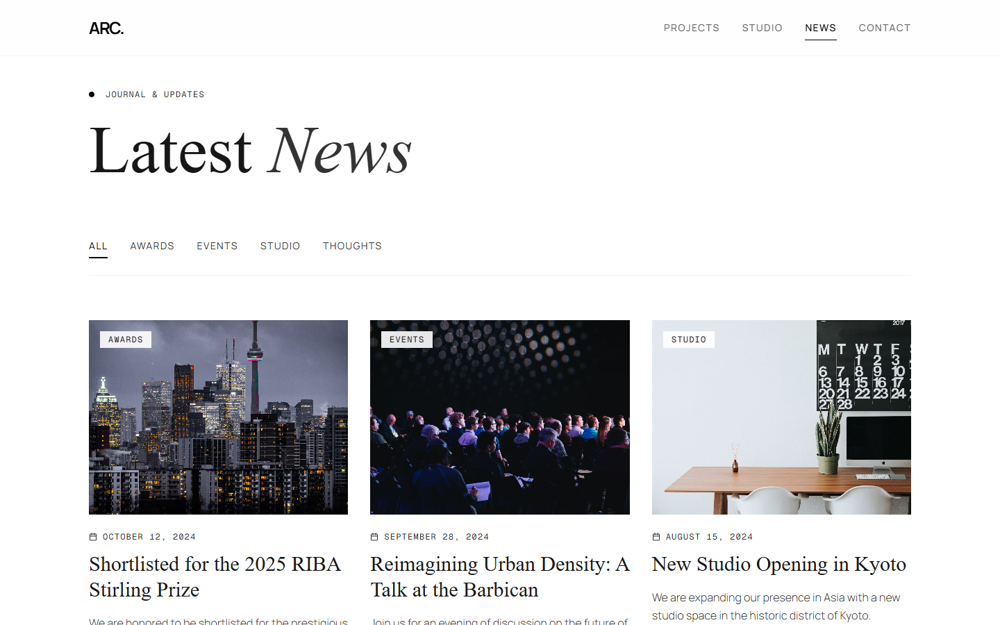
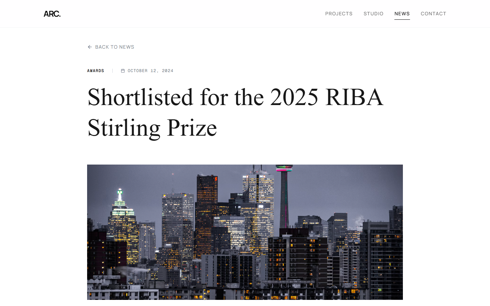
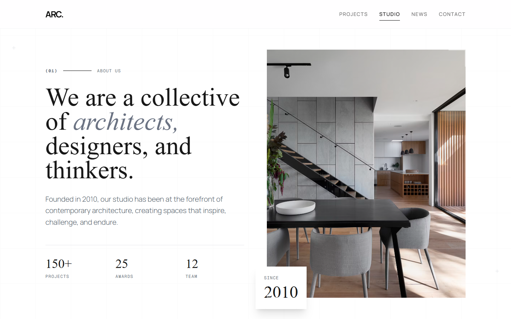
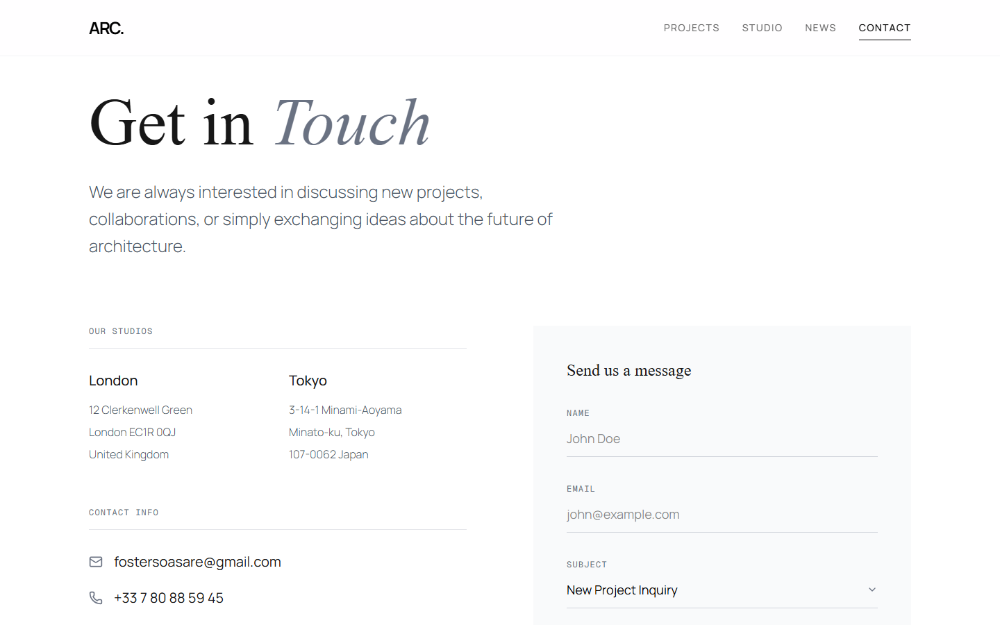
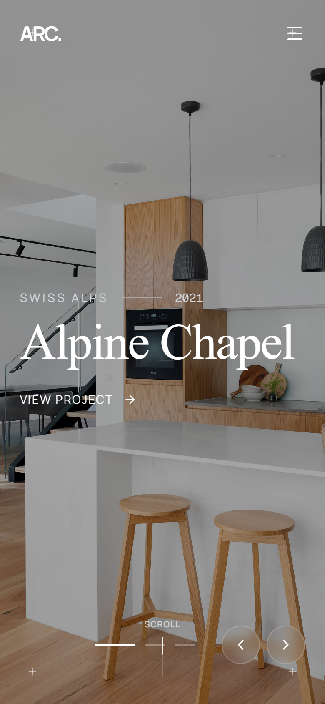
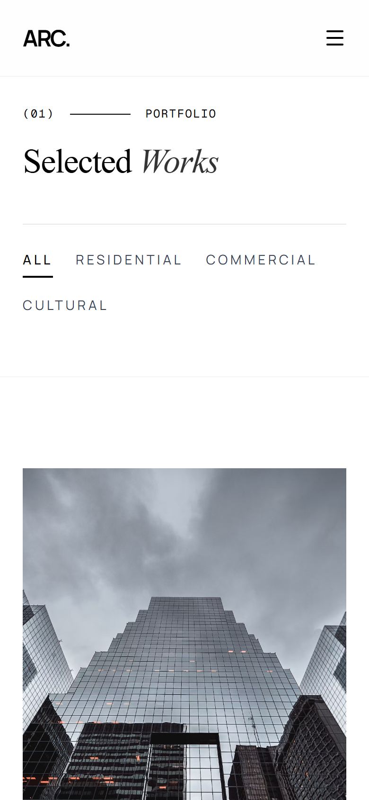
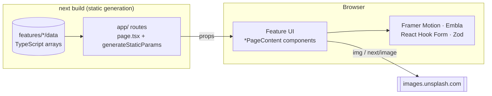

# REAPER

### A portfolio website for an architecture and design studio, with filterable projects, a news journal and smooth editorial motion.


[](https://architecture-iota-lac.vercel.app)

**🌐 Live demo:** [architecture-iota-lac.vercel.app](https://architecture-iota-lac.vercel.app). Try filtering the [projects](https://architecture-iota-lac.vercel.app/projects) by category, or open a project to see its gallery.



---

## Table of contents

- [What is REAPER?](#what-is-reaper)
- [Screenshots](#screenshots)
- [Features](#features)
- [Tech stack](#tech-stack)
- [System architecture](#system-architecture)
- [Managing content](#managing-content)
- [Routes](#routes)
- [Repository layout](#repository-layout)
- [Getting started](#getting-started)
- [Configuration](#configuration)
- [Deployment](#deployment)
- [Known issues](#known-issues)
- [Author](#author)
- [License](#license)

---

## What is REAPER?

REAPER is the website for a fictional architecture and design studio based in London and Tokyo. It does three jobs:

1. **Portfolio.** A grid of the studio's projects that you can filter by category (residential, commercial, cultural). Each project has a full-screen gallery and a details page.
2. **Journal.** News articles about awards, events, studio updates and essays, filtered by category, each with its own page and a copy-link share button.
3. **Studio and contact.** The studio's story, philosophy, values and team, plus a contact page with office addresses and an enquiry form.

All pages are static. There's no database or CMS. Content lives in TypeScript files, and every project and article page is generated at build time.

---

## Screenshots

**Portfolio.** A category filter with an animated underline, and a gallery carousel on each project page.

| Projects | Project detail |
| --- | --- |
|  |  |

**Journal.** A filterable news grid and article pages.

| News | Article |
| --- | --- |
|  |  |

**Studio and contact.**

| Studio | Contact |
| --- | --- |
|  |  |

**Mobile.** Every page is fully responsive, and the navbar collapses into a full-screen menu.

| Home | Projects |
| --- | --- |
|  |  |

---

## Features

**🏛️ Filterable portfolio.** Nine projects across three categories. Changing the filter animates cards in and out with Framer Motion's `AnimatePresence` and layout animations. Clicking a card opens a quick-view modal that links to the full project page.

**🖼️ Project galleries.** Each project page opens with a full-screen Embla carousel that autoplays and loops, with arrows and slide indicators. Below it are the project's location, year, size and description.

**📰 News journal.** Thirteen articles in four categories (Awards, Events, Studio, Thoughts). Article pages render rich HTML content and have a share button that copies the link to the clipboard.

**🏠 Editorial home page.** A hero carousel, featured projects with parallax images, a studio overview, testimonials, awards, a four-step process timeline, the latest news and press mentions. Sections reveal as you scroll.

**✉️ Forms.** The contact form and the footer newsletter signup use React Hook Form with Zod. They validate each field and show toast notifications. *(Both forms are front-end only for now. See [Known issues](#known-issues).)*

**🖱️ Custom cursor.** A dot with a trailing ring on a spring. The ring grows over links and buttons, uses `mix-blend-difference`, and is turned off on touch devices.

**🧭 Adaptive navbar.** On the home page the navbar is transparent over the hero and turns frosted once you scroll. The active link has an animated underline, and on mobile the links open in a full-screen menu.

**🔍 SEO ready.** Site-wide Open Graph and Twitter metadata, a `generateMetadata` title and description for each project and article, and favicons that switch between light and dark.

---

## Tech stack

| Tier       | Technology                                     | Notes                                                           |
| ---------- | ---------------------------------------------- | --------------------------------------------------------------- |
| Framework  | Next.js 16 (App Router), React 19              | Every route is static; dynamic pages use `generateStaticParams` |
| Language   | TypeScript 5                                   | Strict mode, with the `@/*` path alias at the project root      |
| Styling    | Tailwind CSS 4, `clsx`, `tailwind-merge`       | Theme tokens defined with `@theme` in `app/globals.css`         |
| Typography | Manrope, Cormorant Garamond, Geist Mono        | Sans for body text, serif for headings, mono for labels         |
| Animation  | Framer Motion                                  | Scroll reveals, parallax, layout animations, modal and cursor springs |
| Carousels  | Embla Carousel with the Autoplay plugin        | Home hero and project galleries                                 |
| Forms      | React Hook Form, Zod 4, `@hookform/resolvers`  | Schemas live in each feature's `schemas/` folder                |
| UI         | Lucide React, React Toastify                   | Icons and toast notifications                                   |

---

## System architecture



- **Routes stay thin.** Each `app/**/page.tsx` sets the page metadata, looks up any data it needs, and renders a `*PageContent` component from `features/<feature>/ui`.
- **Data is static.** Projects, news, team and home-page content are plain arrays in `features/*/data/index.ts`. Dynamic routes call `generateStaticParams` over those arrays, so every page is prerendered, and unknown IDs return `notFound()`.
- **Interactivity is client-side.** Filters, carousels, the modal, the cursor and forms are client components. Nothing calls a server at runtime.
- **Images** come from Unsplash. Two home sections use `next/image`, which only allows hosts listed in `next.config.ts`. Other pages use plain `` tags.

---

## Managing content

| Content                         | File                                                                 | Used by                     |
| ------------------------------- | -------------------------------------------------------------------- | --------------------------- |
| Projects and project categories | [`features/projects/data/index.ts`](features/projects/data/index.ts) | `/projects`, `/projects/[id]` |
| News articles                   | [`features/news/data/index.ts`](features/news/data/index.ts)         | `/news`, `/news/[id]`       |
| Team and studio values          | [`features/studio/data/index.ts`](features/studio/data/index.ts)     | `/studio`                   |
| Home page sections              | [`features/home/data/index.ts`](features/home/data/index.ts)         | `/`                         |

**To add a project or article:** add an entry with a unique numeric `id`. Its page is generated on the next build. An article's `content` field is an HTML string.

**Home page content is separate.** `features/home/data` has its own `FEATURED_PROJECTS`, `LATEST_NEWS` and `HERO_SLIDES` lists, so when a project or article changes, update it there too. Hero slides link to projects by `projectId`.

**To use images from another host:** add the domain to `images.remotePatterns` in [`next.config.ts`](next.config.ts).

---

## Routes

| Route            | Rendering      | Purpose                                                                 |
| ---------------- | -------------- | ----------------------------------------------------------------------- |
| `/`              | Static         | Home: hero, featured projects, studio, testimonials, awards, process, news, press |
| `/projects`      | Static         | Project grid with a category filter and a quick-view modal              |
| `/projects/[id]` | SSG (9 pages)  | Project gallery and details                                             |
| `/news`          | Static         | News grid with a category filter                                        |
| `/news/[id]`     | SSG (13 pages) | Article with a share button                                             |
| `/studio`        | Static         | About, philosophy, values, team                                         |
| `/contact`       | Static         | Office addresses, contact details and the enquiry form                  |
| `*`              | Static         | Custom 404 page                                                         |

---

## Repository layout

```
architecture/
├── app/                     # Next.js App Router: pages and layouts
│   ├── layout.tsx           # Fonts, site metadata, custom cursor, toast container
│   ├── globals.css          # Tailwind import, theme tokens, scrollbar and selection styles
│   ├── projects/            # Project listing + [id] detail
│   ├── news/                # News listing + [id] article
│   ├── studio/              # About page
│   ├── contact/             # Contact page
│   └── not-found.tsx        # 404 page
├── features/                # Feature-sliced modules
│   ├── home/                # Home sections, home data, newsletter schema
│   ├── projects/            # Project data, header, grid, detail page
│   ├── news/                # News data, listing, article page
│   ├── studio/              # Team and values data, studio page
│   ├── contact/             # Contact form and schema
│   └── layout/              # Navbar and custom cursor
├── components/ui/           # Shared UI (ProjectModal)
├── docs/screenshots/        # README screenshots
└── public/                  # Logo, favicons, images
```

Each folder in `features/` keeps its own `ui/`, `data/` and `schemas/`. Code for one domain stays together instead of being spread across global `components/` and `utils/` folders.

---

## Getting started

### Prerequisites

- Node.js 20.9 or newer (required by Next.js 16)
- npm

### 1. Clone

```bash
git clone https://github.com/FosterSOAsare/architecture.git
cd architecture
```

### 2. Install

```bash
npm ci
```

### 3. Run

```bash
npm run dev
```

Open [http://localhost:3000](http://localhost:3000).

### Scripts

| Command         | Description                  |
| --------------- | ---------------------------- |
| `npm run dev`   | Start the dev server         |
| `npm run build` | Create a production build    |
| `npm run start` | Serve the production build   |
| `npm run lint`  | Run ESLint                   |

---

## Configuration

No environment variables are needed. The only settings to know about are:

| Setting                     | Where                          | Purpose                                         |
| --------------------------- | ------------------------------ | ----------------------------------------------- |
| `images.remotePatterns`     | `next.config.ts`               | Hosts that `next/image` may load from (Unsplash) |
| `metadataBase`, Open Graph  | `app/layout.tsx`               | Canonical URL and social share cards. Update this if the domain changes |
| Theme tokens                | `app/globals.css`              | `--background`, `--foreground` and the `--secondary` accent colour |

---

## Deployment

| Piece   | Host                                                       | Why                                                     |
| ------- | ---------------------------------------------------------- | ------------------------------------------------------- |
| Web app | Vercel ([live](https://architecture-iota-lac.vercel.app))   | First-class Next.js support. The whole site is static, so it's served from the edge |

The site is fully static, so any host that runs `npm run build && npm run start` will work too.

---

## Known issues

| Area    | Issue |
| ------- | ----- |
| Forms   | The contact and newsletter forms fake a request: they wait, log the data and show a success toast. Connect them to an email service or API route before relying on them. |
| Content | Home page data duplicates the projects and news data, and the IDs don't match for two projects: in the home modal, "View Full Project" for *Aesop Store* and *Nordic Maritime Museum* opens the other one. |
| Content | News articles 5 and 9 have no `content`, so their pages have an empty body. |
| Copy    | The logo reads "ARC.", and the studio stats (awards, team size) don't match across pages. |
| Lint    | `npm run lint` reports unescaped quotes in JSX and `setState` calls inside effects. The production build is unaffected. |
| Accessibility | No `prefers-reduced-motion` support. The project modal has no Escape-to-close or focus trap. The custom cursor hides the system cursor on desktop. |

---

## Author

| Member                        | GitHub                                             |
| ----------------------------- | -------------------------------------------------- |
| Foster Solomon Owusu Asare    | [@FosterSOAsare](https://github.com/FosterSOAsare) |

---

## License

No license has been chosen yet, so all rights are reserved by the author. Add a `LICENSE` file to change that.
